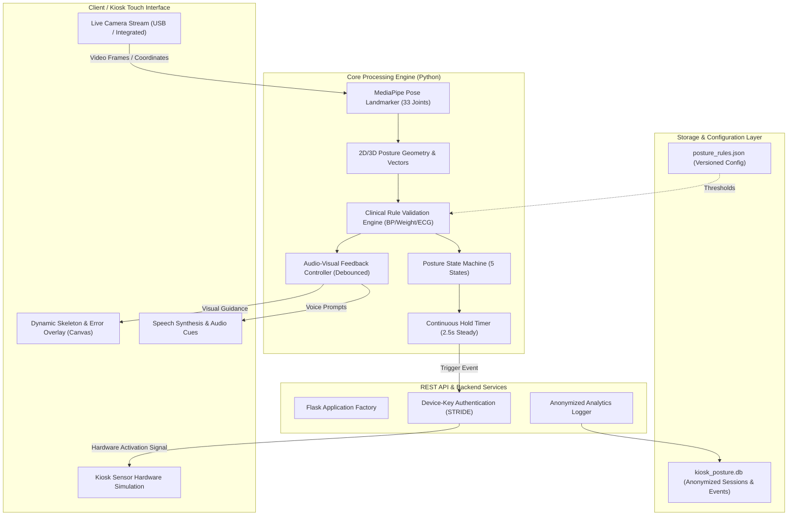
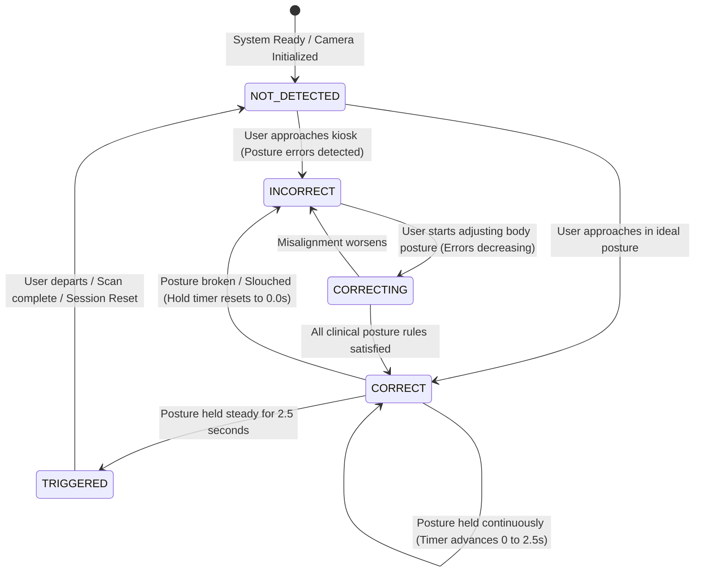
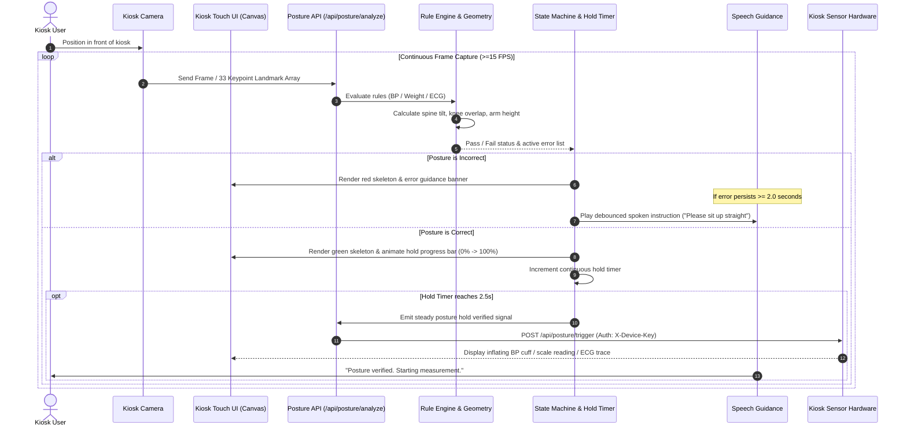
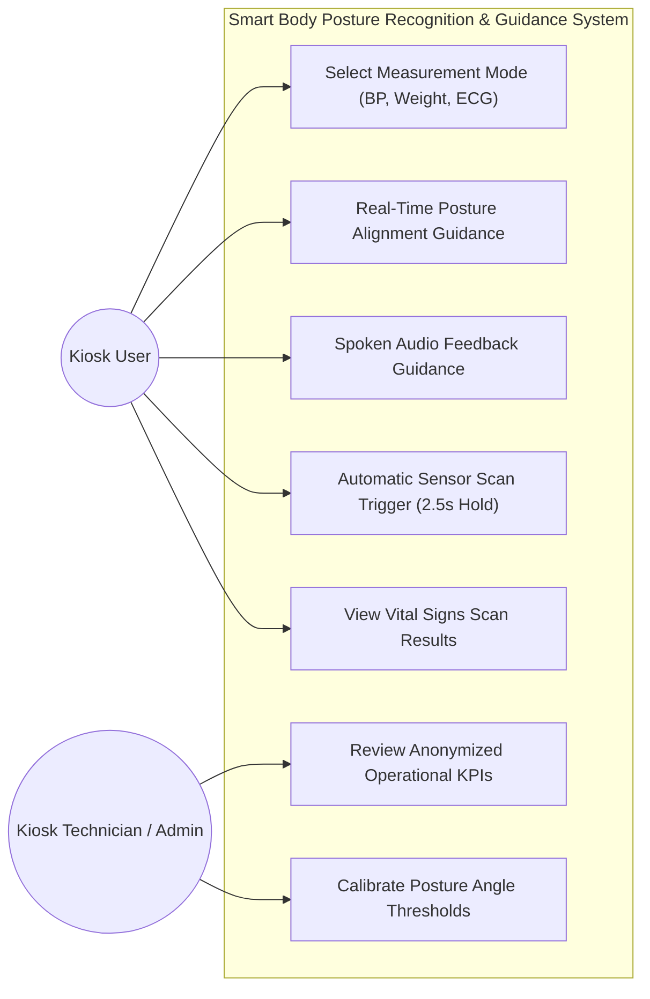
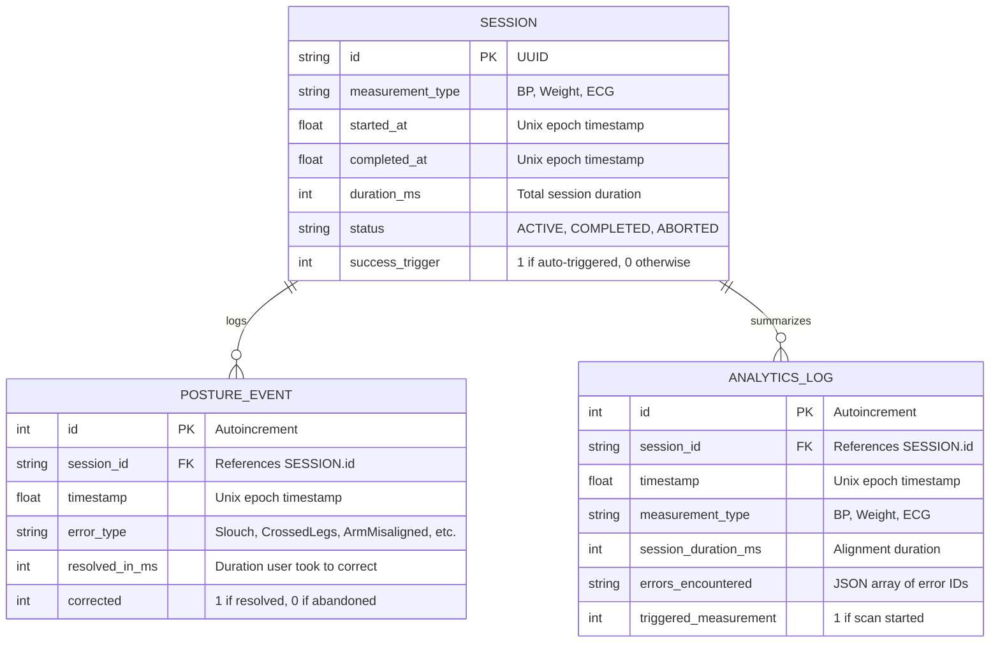

# Technical Architecture Specification
## Smart Body Posture Recognition & Guidance System
**GLA University — Department of Computer Science Engineering & Applications**  
**Team OG-Coders (T-89)** | **Academic Year: 2025–2026**

---

### 1. High-Level Architecture Overview
The system is engineered as an edge-ready, real-time posture correction layer positioned directly before automated diagnostic health kiosks. It enforces clinical positioning rules for Blood Pressure (BP), Body Weight/BMI, and Electrocardiogram (ECG) measurements to prevent distorted physiological readings.



---

### 2. State Transition Diagram
Represents the user alignment lifecycle at the kiosk as defined in Section 12 of the project synopsis:
`Not Detected -> Incorrect -> Correcting -> Correct -> Triggered`



---

### 3. Sequence Diagram: Frame Processing to Sensor Activation
Shows chronological interactions across components during an active vitals measurement check-in:



---

### 4. Use Case Diagram
Defines the functional interactions of kiosk users and clinical technicians:



---

### 5. Data Flow Diagram (DFD Level 1)
Details the flow of information from raw video capture to anonymized analytics logging:

```mermaid
flowchart TD
    P0["Raw Camera Stream (640x480)"] --> D1["1.0 Keypoint Detection"]
    D1 -->|33 Landmark Coordinates (x,y,z)| D2["2.0 Biomechanical Geometry Analysis"]
    D2 -->|Spine Angle, Knee Distance, Arm Offset| D3["3.0 Rule Engine Validation"]
    
    RConfig[("Config Store: posture_rules.json")] -.->|Rule Parameters & Thresholds| D3
    
    D3 -->|Posture Errors & Violations| D4["4.0 Visual & Audio Controller"]
    D4 -->|Canvas Overlay & Spoken Prompts| UI["Kiosk Screen & Audio Speaker"]
    
    D3 -->|Validation Status| D5["5.0 Hold Timer & State Machine"]
    D5 -->|Steady 2.5s Hold Signal| D6["6.0 Hardware Sensor Trigger"]
    D6 -->|Device-Key Authenticated Request| KioskSensor["Vital Signs Hardware / Diagnostic Unit"]
    
    D5 -->|Anonymized Event Stream| D7["7.0 Analytics & Audit Logger"]
    D7 --> LogDB[("SQLite DB: kiosk_posture.db")]
    LogDB --> AdminUI["Admin KPI Dashboard"]
```

---

### 6. Entity Relationship Diagram (ERD)
Database schema implemented in SQLite as specified in Section 11 of the synopsis:



---

### 7. Security and Threat Model (STRIDE)
As evaluated in Section 14 of the project synopsis:

| Asset | Threat (STRIDE) | Severity | Mitigation Implemented |
|---|---|---|---|
| **Camera Video Stream** | Information Disclosure | High | Real-time in-memory inference; raw frames are immediately discarded after keypoint extraction; zero PII / facial data stored. |
| **Sensor Trigger API** | Spoofing / Tampering | Medium | Protected with `X-Device-Key` header authentication (`@require_device_key` decorator) restricting trigger access to local kiosk hardware. |
| **Audit Logs** | Repudiation | Low | Immutable SQLite session records with UUIDs, duration metrics, and ISO timestamps. |
| **System Availability** | Denial of Service | Medium | Client-side debouncing and low-resolution (320x240) image scaling keeping frame latency <50ms (p95 SLA <= 300ms). |
